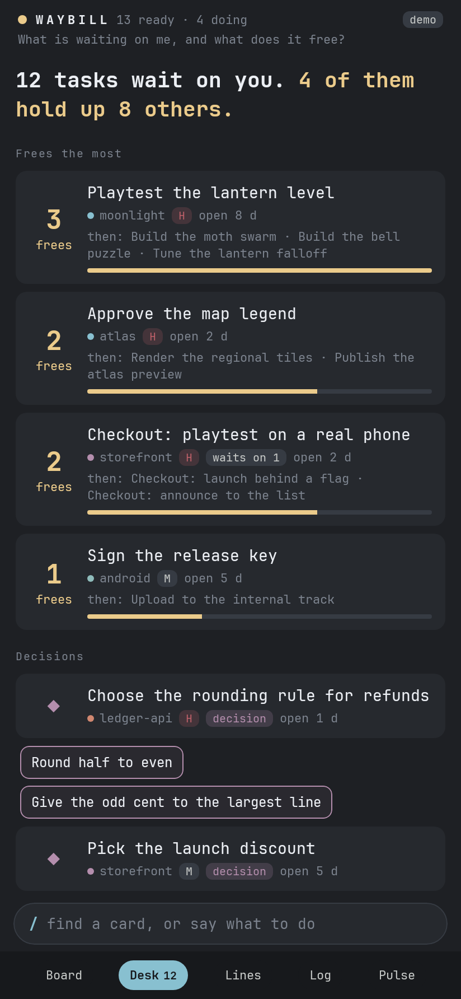
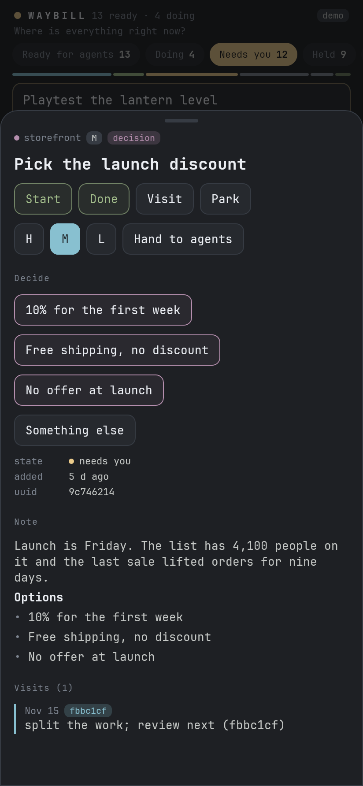
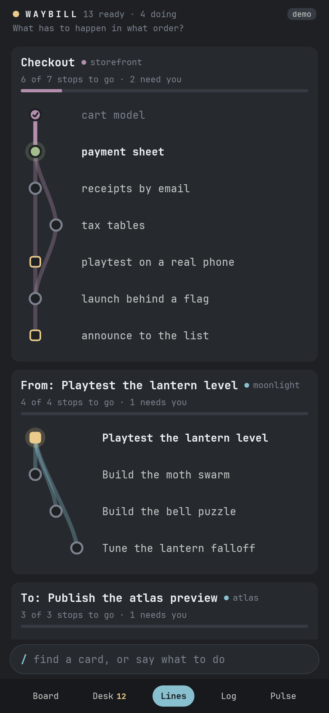
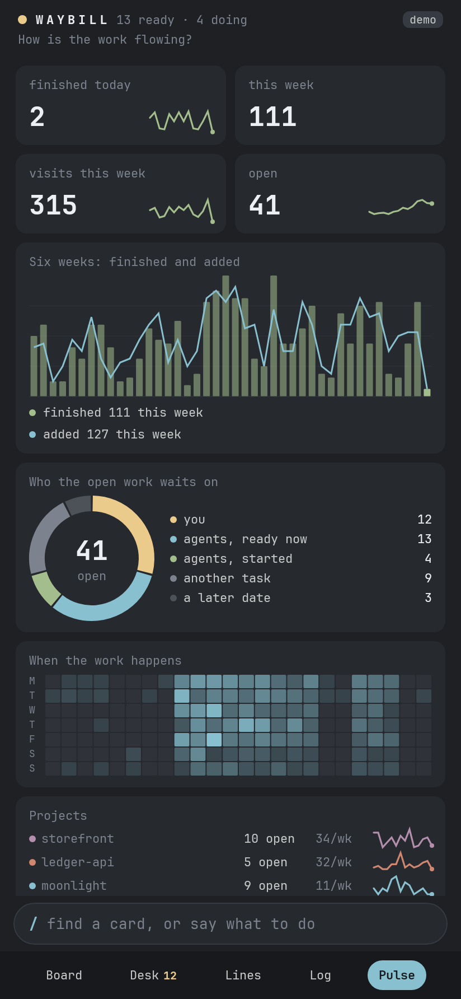
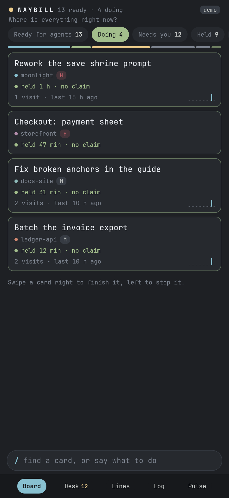
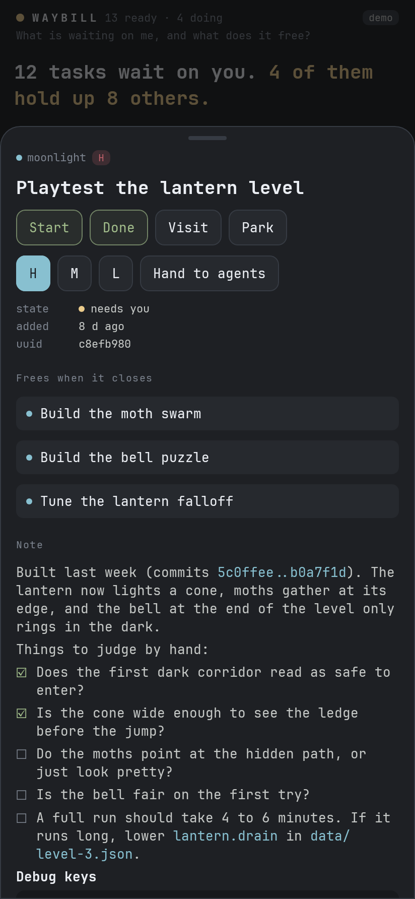
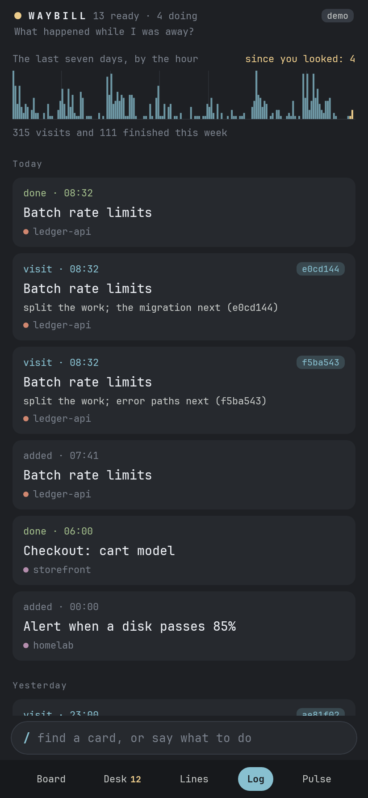

<h1 align="center">Waybill</h1>

<p align="center">
  <b>A board for Taskwarrior on a desk where agents do the building.</b><br>
  Five views of one task list, redrawn as your sessions write to it,<br>
  a lamp in your bar that turns amber only when the work is waiting on you,<br>
  one command that holds the whole pick-up protocol for your agents,<br>
  and an Android app that carries the same board in your pocket.
</p>

<p align="center">
  
  
  
  
</p>

<p align="center">
  
</p>

A waybill is the paper that rides with every freight car: what it carries,
where it is bound and who handled it at each stop.
[Switchyard](https://github.com/NathanielInman/switchyard) dispatches your
work, [Roundhouse](https://github.com/NathanielInman/roundhouse) says whether
the machine is fit to run it, and Waybill says what each piece of work is and
who is carrying it.

## Why

My task list stopped being a to-do list in October. Agents add the cards,
start them, log a line on every visit and close them: 1,993 tasks in six
weeks, across 31 projects. My part is the playtests, the art, the accounts
and the rulings.

I was watching all of that in vit. One report, sorted by urgency. Every visit
an agent logged collapsed into a `[3]`. The long-form note sat behind a key I
bound myself, which left the list for nvim. A dependency was a column of ids,
and nothing told me that playtesting one build would start three others.
vit is a fine keyboard front end for one person's list. It was never meant to
show one person what a room full of sessions is doing.

Waybill is organized around the one split my list cares about: work an agent
can take, and work that needs **my hands**.

- **Your queue, shortest first.** 30 of my 76 open tasks wait on me, and four
  of those hold up seven others. Desk sorts my tasks by what closes behind
  them.
- **It redraws itself.** The board watches the task database and rereads it
  when a session writes, so cards move while you look at them.
- **A ruling is one click.** An agent files a decision with its options. I
  click one, on the board or in the bar drawer, and the ruling is written the
  way my agents already write it: a visit that starts with my name.
- **Somebody holds every started task.** `waybill next` starts a task under a
  **claim** naming the session. When that session is gone the card says so,
  and the next pick stops it.
- **Charts that answer something.** Are we finishing more than we add? Who
  is the open work waiting on? When does the work happen?
- **Nothing to memorize.** Every button prints its key, a card drags to the
  lane you mean, and `/` takes plain words: "high", "wait until friday",
  "done shipped it".
- **It goes where you go.** The Android app shows the same five views and
  the drawer, and a decision an agent files reaches your phone as a
  notification whose buttons are its options. See
  [On your phone](#on-your-phone).
- **Still plain Taskwarrior.** Every read is `task export` and every write is
  a `task` command. Waybill keeps no database, so `task` and vit work beside
  it.

## The views

<p align="center">
  
</p>

<p align="center"><sub><b>Pulse.</b> Six weeks of what was added and finished, open work split by who it waits on, when the work happens, where it goes and how long a task lives. Hover any chart for the numbers.</sub></p>

<table>
  <tr>
    <td width="50%" valign="top"><br><b>Board.</b> Where is everything right now? Ready for agents, doing, needs you, held, done today. A started card names the session that holds it. Drag a card to Doing to start it, to Done to finish it, to Needs you to take it.</td>
    <td width="50%" valign="top"><br><b>Desk.</b> What is waiting on me, and what does it free? My tasks ranked by how much agent work each one releases, and decisions with their options as buttons.</td>
  </tr>
  <tr>
    <td valign="top"><br><b>Lines.</b> What has to happen in what order? Every dependency chain is a rail line. Round stops are for agents, square stops need you, and the travelled track is the work already done.</td>
    <td valign="top"><br><b>Log.</b> What happened while I was away? Every visit, ruling and finished task, newest first, under a week of activity by the hour.</td>
  </tr>
  <tr>
    <td valign="top"><br><b>A card.</b> Click anything to open it. Start, finish, log a visit, park it, change its priority, hand it to the agents or take it, and edit the note, each one a button with its key on it.</td>
    <td valign="top"><br><b>The drawer.</b> A click on the bar lamp opens the short version: what waits on you, decisions you can settle on the spot, and how the week is going.</td>
  </tr>
</table>

These are screenshots of `waybill-board --demo`, a made-up studio's list you
can open without touching your own.

## On your phone

Waybill for Android is the board for when you are away from the desk. It
shows the same five views with the same cards in the same order and the
same colors, because it decides nothing itself: `waybill serve` on the desk
sends it what the board would draw, and it sends back the words the board's
`/` line reads. A lane rule, a button or a `/` word added to the desk works
on the phone as soon as the desk runs the new build, with no change to the
app.

<table>
  <tr>
    <td width="33%" valign="top"><br><b>Desk</b> is home: what waits on you, and what each of those frees. A decision's options are one tap each.</td>
    <td width="33%" valign="top"><br><b>Board</b>, one lane at a time. Swipe a card right to finish it, left to start or stop it.</td>
    <td width="33%" valign="top"><br><b>A card</b> slides up with the buttons the board shows, from the same list in the core.</td>
  </tr>
  <tr>
    <td valign="top"><br><b>Lines</b> run down the screen, so a long line scrolls instead of shrinking.</td>
    <td valign="top"><br><b>Log</b> counts what came in since you last looked.</td>
    <td valign="top"><br><b>Pulse</b>, stacked: the same numbers the board charts.</td>
  </tr>
</table>

Outside the app:

- **Decisions as notifications.** A new decision shows up with up to three
  of its options as buttons, or two and a reply in your own words. A tap
  writes the ruling, signed with your name, just as a click on the board
  does. An alarm comes first, in red.
- **The drawer as a widget.** The lamp, the headline, the top of your
  queue and the day's count, on the home screen.
- **The lamp as a tile.** A Quick Settings tile lit while something waits
  on you.

The phone looks at the desk every 15 minutes for the widget, the tile and
notifications (Android's shortest period), and follows it live while the
app is open.

### Setting it up

On the desk, start the server and pair the phone:

```sh
waybill serve      # leave it running; packaging/waybill-serve.service does that
waybill pair       # prints a QR code: scan it with the phone's camera
```

Build the app with `./gradlew assembleRelease` in `android/` and install
`app/build/outputs/apk/release/app-release.apk` (or `adb install` it), or
take the APK from the latest run of the Android workflow. It needs Android
10 or newer.

The phone has to reach the desk: the same Wi-Fi, or a VPN to your home
network. Without a certificate `waybill serve` speaks plain HTTP, which
anyone on that network can read; set `serve.cert` and `serve.key` (a LAN
DNS name with a Let's Encrypt certificate works) and it speaks HTTPS.
`waybill doctor` says whether a phone is paired and whether the
certificate loads, and `waybill pair --new` unpairs the old phone.

These screenshots are drawn by `./gradlew recordRoborazziDebug` from the
same made-up list as `waybill-board --demo`.

## Install

Waybill is built from source for now. It needs Rust, GTK 4.12 or newer,
gtk4-layer-shell and Taskwarrior.

```sh
git clone https://github.com/NathanielInman/waybill && cd waybill
cargo build --release
install -Dm755 target/release/waybill target/release/waybill-board -t ~/.local/bin
install -Dm644 packaging/io.github.nathanielinman.Waybill.desktop -t ~/.local/share/applications
waybill doctor
```

Waybill keeps a task's marker in a `ref` field, so the taskrc needs
`uda.ref.type=string` (and `uda.ref.label=Ref` for Taskwarrior's reports).
`waybill doctor` checks that, Taskwarrior 3 and its data location, the
config, the notes folder, the waybar module, GTK 4 and gtk4-layer-shell, and
the launcher entry, and exits 1 when something is broken.

Then `waybill-board`, or `waybill-board --demo` to look around first.

## Doing things on the board

Open a card and the pane shows what you can do, each button with its key:

| Key | Does |
|---|---|
| `s` | Start it, or stop it |
| `d` | Finish it, with an optional closing line |
| `v` | Log a visit |
| `w` | Park it until a date, or bring it back |
| `h` `m` `l` | Set the priority |
| `t` | Take it (it needs your hands), or hand it to the agents |
| `e` | Edit the note |
| `a` `b` `c` | On a decision: choose that option. `o` writes your own ruling |

`1` to `5` change the view, `n` starts a new task and `/` goes to the line
at the bottom. Type there to find a card, or with a card open say what to do:
`high`, `mine`, `hand to agent`, `wait until friday`,
`visit tried it, feels slow`, `done shipped in a1b2c3d`.

`Esc` closes the innermost thing open: it leaves the line, a note you are
editing or the new-task form first, then closes the card, and with nothing
open closes the board (right-click the lamp to bring it back).

What you write is signed. A visit typed on the board is logged as
"Nate: ...", the same way an agent records something you told it.

## For agents

```sh
waybill next --project detour-33   # clear abandoned starts, pick, start, claim
waybill visit 551e6a8e "handshake done; clock sync next (a1b2c3d)"
waybill done  551e6a8e "built in baab3e7"      # prints what that freed
```

`waybill next` is the pick-up protocol in one command. It stops starts whose
session is gone, lists the ones that have run for over 12 hours, picks the
most urgent task that is ready (not yours, not a decision, not held, not
started, not parked), starts it and leaves a claim. What it prints is the
brief: the uuid, the note's path, the marker, the visits so far, what the
task frees. Add `--json` to any command for JSON.

```sh
waybill ask --project etb --option "Keep 4 s" --option "Lower it to 2 s" \
  --context "The MUD waits 4 s between basic attacks." -- "Settle the global cooldown"
```

`waybill ask` files a decision for you with its options. `waybill add` adds a
task with its note in one command, `waybill find` searches titles, visits and
notes before you add, `waybill edit` changes a task's priority, tags, project,
title or ref, `waybill note` prints, replaces or adds to a task's note,
`waybill show` prints a task in full,
`waybill lint` lists open tasks that break the house rules (a title over 50
characters, an unknown tag, no project), and `waybill --help` has the rest.
`add` and `ask` refuse a new task that lint would flag, so a bad card never
reaches the list; `--force` files it anyway.

A task is named by its uuid or the first 8 characters of it. Waybill never
uses Taskwarrior's numbers, which change whenever a task closes.

## The bar

```jsonc
"custom/waybill": {
  "exec": "~/.local/bin/waybill bar",
  "restart-interval": 5,
  "return-type": "json",
  "on-click": "~/.local/bin/waybill toggle",
  "on-click-right": "~/.local/bin/waybill-board",
  "tooltip": true
}
```

The lamp is amber when a task of yours holds other work up or a decision is
open, and shows how many. It turns red while a task tagged `alarm` is open:
something broke and should be looked at first, like a nightly job that
failed. Otherwise it is calm. A click opens the drawer at
the icon; a right-click opens the board. The module's class is `calm`,
`needs-you`, `alarm` or `error`:

```css
#custom-waybill.calm { color: #616e88; }
#custom-waybill.needs-you { color: #ebcb8b; }
#custom-waybill.alarm { color: #bf616a; }
#custom-waybill.error { color: #bf616a; }
```

## A board that lives on a workspace

Out of the box the board is an ordinary window: start it when you want it,
close it when you are done. It can also be the thing that is always open on
one workspace, the way a terminal list used to be. That is a choice for your
compositor's config, and Waybill is built to be used that way:

- **One board.** A second `waybill-board` does not open a second window. It
  hands itself to the one already running, which comes forward. So the bar
  lamp's right-click, the drawer's "Open the board" and a click on a drawer
  row all land on the board you already have, on the card you clicked,
  whatever workspace it lives on.
- **A stable class.** The window's app id is
  `io.github.nathanielinman.Waybill`, for window rules.
- **Fullscreen, if you want it.** `waybill-board --fullscreen`, or
  `fullscreen = true` under `[board]`, covers the bar. Without it the window
  fills whatever the compositor gives it.

On Hyprland, for a board that is always on workspace 6:

```ini
exec-once = [workspace 6 silent] waybill-board
windowrule = workspace 6, class:io.github.nathanielinman.Waybill
```

Coming forward across workspaces is asked of the compositor (Hyprland and
sway today); elsewhere the board asks for attention and stays where it is.

## Config

`~/.config/waybill/config.toml`. Every key is optional
([`packaging/examples/config.toml`](packaging/examples/config.toml) has them
all with their defaults). The one worth setting is the tag that marks a task
as yours:

```toml
[tags]
hands = ["nate"]        # these tasks need my hands; agents leave them
decision = "decision"   # blocked on a choice of mine
alarm = "alarm"         # something broke: the lamp goes red, the card too
```

A task with a `hands` tag or the `decision` tag lands in **Needs you**. A
visit that opens with the first hands tag ("Nate: full game $5") is a
**ruling**, and the log marks it.

Notes are `<uuid>.md` files in `notes/` under Taskwarrior's `data.location`;
set `notes.dir` if yours live elsewhere. A decision's options are the bullets
under an `## Options` heading in its note. The board borrows its colors and
font from `~/.config/waybar/style.css` when there is one
(`theme.from = "none"` turns that off), and `~/.config/waybill/style.css`
overrides anything.

[`docs/design.md`](docs/design.md) is the spec.
