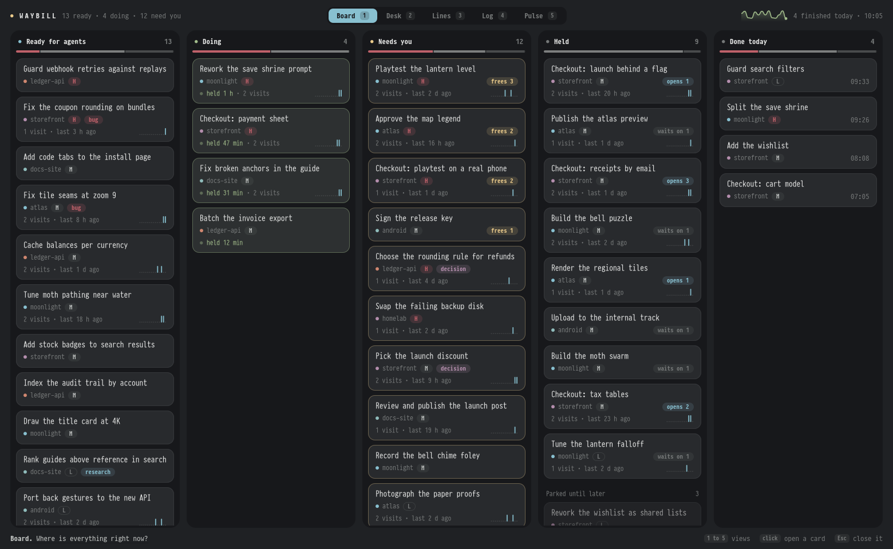

<h1 align="center">Waybill</h1>

<p align="center">
  <b>A board for Taskwarrior on a desk where agents do the building.</b><br>
  Five views of one task list, redrawn as your sessions write to it:<br>
  what is ready, what is started, what waits on you and what that would free.
</p>

<p align="center">
  
</p>

A waybill is the paper that rides with every freight car: what it carries,
where it is bound and who handled it at each stop.
[Switchyard](https://github.com/NathanielInman/switchyard) dispatches your
work, [Roundhouse](https://github.com/NathanielInman/roundhouse) says whether
the machine is fit to run it, and Waybill says what each piece of work is and
who is carrying it.

## Why

My task list stopped being a to-do list in October. Agents add the cards,
start them, log a line on every visit and close them: 1,993 tasks in six
weeks, across 31 projects. My part is the playtests, the art, the accounts
and the rulings.

I was watching all of that in vit. One report, sorted by urgency. Every visit
an agent logged collapsed into a `[3]`. The long-form note sat behind a key I
bound myself, which left the list for nvim. A dependency was a column of ids,
and nothing told me that playtesting one build would start three others.
vit is a fine keyboard front end for one person's list. It was never meant to
show one person what a room full of sessions is doing.

Waybill is organized around the one split my list cares about: work an agent
can take, and work that needs **my hands**.

- **Your queue, shortest first.** 30 of my 76 open tasks wait on me, and four
  of those hold up seven others. Desk sorts my tasks by what closes behind
  them.
- **It redraws itself.** The board watches the task database and rereads it
  when a session writes, so cards move while you look at them.
- **The record is readable.** Visits, rulings and commits across every
  project in one log, and a card's note laid out next to its history.
- **Charts that answer something.** Are we finishing more than we add? Who
  is the open work waiting on? When does the work happen?
- **Nothing to memorize.** It is a window with a pointer. The views are the
  digits 1 to 5 and every key is printed where you use it.
- **Still plain Taskwarrior.** Waybill reads through `task export` and keeps
  nothing of its own. `task` and vit work beside it.

## The views

<table>
  <tr>
    <td width="50%" valign="top"><br><b>Board.</b> Where is everything right now? Ready for agents, doing, needs you, held, done today. A card says what it frees, how long it has been held and how busy it has been.</td>
    <td width="50%" valign="top"><br><b>Desk.</b> What is waiting on me, and what does it free? My tasks ranked by how much agent work each one releases, then decisions, then the rest by project.</td>
  </tr>
  <tr>
    <td valign="top"><br><b>Lines.</b> What has to happen in what order? Every dependency chain is a rail line. Round stops are for agents, square stops need you, and the travelled track is the work already done.</td>
    <td valign="top"><br><b>Log.</b> What happened while I was away? Every visit, ruling and finished task, newest first, under a week of activity by the hour.</td>
  </tr>
  <tr>
    <td valign="top"><br><b>A card.</b> Click anything to open it: the note with its checklists, what it waits on, what it frees and every visit with the commits it names.</td>
    <td valign="top"><b>Pulse</b> is the picture at the top of this page: six weeks of what was added and finished, open work split by who it waits on, a heat map of when the work happens, projects and how long a task lives. Hover any chart for the numbers.</td>
  </tr>
</table>

These are screenshots of `waybill-board --demo`, a made-up studio's list you
can open without touching your own.

## Install

Waybill is built from source for now. It needs Rust, GTK 4.12 or newer and
Taskwarrior 3.

```sh
git clone https://github.com/NathanielInman/waybill && cd waybill
cargo build --release
install -Dm755 target/release/waybill target/release/waybill-board -t ~/.local/bin
install -Dm644 packaging/io.github.nathanielinman.Waybill.desktop -t ~/.local/share/applications
```

Then `waybill-board`, or `waybill-board --demo` to look around first.

## Config

`~/.config/waybill/config.toml`. Every key is optional
([`packaging/examples/config.toml`](packaging/examples/config.toml) has them
all with their defaults). The one worth setting is the tag that marks a task
as yours:

```toml
[tags]
hands = ["nate"]        # these tasks need my hands; agents leave them
decision = "decision"   # blocked on a choice of mine
```

A task with a `hands` tag or the `decision` tag lands in **Needs you**. A
visit that opens with the first hands tag ("Nate: full game $5") is a
**ruling**, and the log marks it.

Notes are `<uuid>.md` files in `notes/` under Taskwarrior's `data.location`;
set `notes.dir` if yours live elsewhere. The board borrows its colors and
font from `~/.config/waybar/style.css` when there is one
(`theme.from = "none"` turns that off), and `~/.config/waybill/style.css`
overrides anything.

## The command line

```sh
waybill lanes       # each lane's count and its first cards
waybill snapshot    # everything the board draws, as JSON
```

`waybill snapshot` is the same model the board draws from: lanes, what each
task frees, the lines, the log and the numbers behind the charts.

## Where it stands

Waybill is at the first of four stops, and today it only reads.

1. **Look** (here): the live board, all five views, the card pane.
2. **Touch**: start, stop, finish, visit and add from the board, through the
   `task` binary. Decisions answered with one key.
3. **Agents**: `waybill next`, `visit` and `done` with JSON out, so the
   pick-up protocol lives in one command, and live claims that say which
   session holds a started task.
4. **The bar**: a waybar lamp that turns amber only when something waits on
   you, and a small Desk drawer.

[`docs/design.md`](docs/design.md) is the spec.
