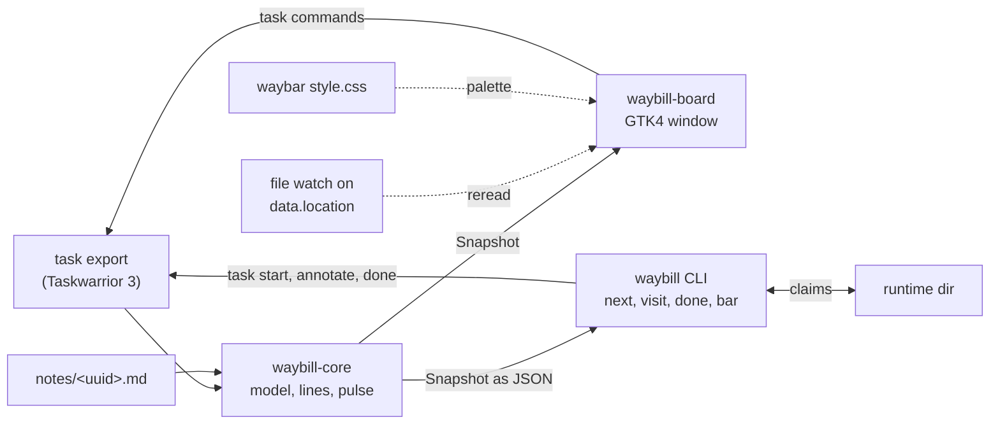

# Waybill design

Waybill is a board for a Taskwarrior list that agents write and a person
steers. It reads the list through `task export`, sorts it by who each task is
waiting on, and draws it five ways in a GTK4 window that rereads the list
whenever the database changes.

This document is the reference for how it works and why. The README is the
tour; this is the spec.

## Goals

1. **Show who the work waits on.** Every open task is waiting on an agent,
   on the user, on another task or on a date. That split is the layout.
2. **Rank the user's queue by what it frees.** The first thing on the desk
   is the task whose closing starts the most other work.
3. **Stay current without being asked.** A change to the database shows up
   on the board within about a second.
4. **Make the record readable.** Visits, rulings, commits and notes are
   shown as history and prose, not as counts.
5. **Draw the numbers.** Flow, open work, working hours and lifetimes are
   charts you can hover, not reports you run.
6. **Ask nothing of memory.** Everything is reachable with the pointer, and
   every key is printed where it applies.
7. **Leave Taskwarrior in charge.** Waybill keeps no database of its own:
   it reads through `task export` and writes through `task` commands.
8. **Hold the protocol for the agents.** Picking up, logging and finishing a
   task are single commands with JSON out, so the rules live in one binary
   instead of in every session's instructions.

## Non-goals

- **Not a Taskwarrior replacement.** `task` owns the data, urgency, sync and
  hooks.
- **Not a team tracker.** One person, their machine, their agents.
- **Not a terminal UI.** It is a window, drawn with GTK and cairo.

## Vocabulary

| Term | Meaning |
|---|---|
| Card | One task as the board shows it. |
| Lane | Where an open card stands: ready, doing, yours, held or parked. Finished cards are done (today) or past (this week). |
| Hands tag | A tag that means the task needs a person: `tags.hands` in the config. |
| Yours | A task with a hands tag or the decision tag. |
| Visit | An annotation: one line an agent or the user logged while working the task. |
| Ruling | A visit that opens with the user's name ("Nate: ..."): a decision, recorded. |
| Frees | The open tasks that cannot start until this one closes, however far down the chain. |
| Line | A group of tasks tied together by `depends`, drawn as a rail line. |
| Stop | One task on a line. |
| Note | The task's long-form Markdown file, `<uuid>.md`. |
| Snapshot | Everything the views draw, built in one pass from one export. |

## Architecture



Three crates:

- **`waybill-core`**: pure functions from exported tasks to a `Snapshot`.
  No UI and no clock of its own: callers pass `now` and a `Zone`, which is
  what makes it testable and lets the demo and screenshots be exact.
- **`waybill`**: the CLI and the waybar module.
- **`waybill-board`**: the window, and with `--drawer` the Desk drawer.
- **`bar-anchor`**: where the bar icon is, for the drawer, from the
  shared [bar-anchor](https://github.com/NathanielInman/bar-anchor) crate.

There is no daemon. The board reads the list itself on a worker thread,
claims are files that anyone can judge, and the only resident process is
`waybill bar`, which waybar keeps running.

### Reading the list

One command reads everything:

```
task rc.verbose=nothing rc.gc=off rc.confirmation=off rc.json.array=on export
```

`rc.gc=off` matters: without it a report can renumber task ids as a side
effect, and looking at the list would change it. Waybill addresses tasks by
uuid and never by id.

`task.command` may carry arguments (`task rc:~/work.taskrc`). The notes
folder is `notes/` under `task _get rc.data.location` unless `notes.dir`
names another. Only the names of the note files are read up front; a note's
text is read when its card is opened.

A failed read becomes a snapshot with `error` set, and the board shows the
reason in a banner over whatever it drew last.

### Staying current

The board holds a directory watch on `data.location` and one on the notes
folder. A change wakes the loader thread, which waits 350 ms for the burst
to finish and reads once. It also rereads every 60 seconds so that elapsed
times ("held 12 min") keep counting.

Reading the database can touch its files (SQLite's journal), which would
wake the watch and loop forever. So the loader keeps a `quiet` deadline:
watch events are ignored while a read is running and for 1.5 seconds after
it. A real change that lands inside that window is picked up by the next
60-second read.

Views that are not on screen are marked stale and redrawn when they are
next shown.

## The model

### Lanes

An open task (pending, or Taskwarrior 2's `waiting`) goes to the first lane
that fits:

| Lane | Rule |
|---|---|
| Doing | It has a `start`. |
| Parked | Its `wait` date is in the future. |
| Yours | It has a hands tag or the decision tag. |
| Held | One of its `depends` is still open. |
| Ready | None of the above: an agent can pick it up. |

A finished task is **done** if it closed since local midnight and **past**
if it closed in the last seven days. Past cards are not on the board; they
exist so the log and the card pane can open them. Deleted and older
finished tasks have no card.

A card of yours that is also blocked stays in Yours, with `blocked` set, so
the desk shows everything that will need the user and says which of it
cannot start yet.

Lane order: Doing by start time; Done by finish time, newest first; Yours
by how many tasks it frees, then unblocked first, then priority, then
urgency; the others by Taskwarrior's urgency.

### What a card frees

`frees` is the transitive closure of open dependents: everything that waits
on this task directly or through other open tasks. `waits_on` is the direct
open dependencies. A finished dependency holds nothing.

The header lamp is red while an alarm is open or when the list could not be
read, and amber when a task of the user's frees anything or a decision is
open.

### Lines

Open tasks joined by `depends` form groups (union-find over the edges). A
finished dependency stays on its line for 14 days, so a line shows the track
already travelled. A group with one stop is not a line.

Each stop gets:

- a **column**: the longest run of stops that must close before it;
- a **track**: the tallest child (the one with the longest run after it)
  continues its parent's track, and every other branch takes the next free
  track. The trunk therefore runs straight and branches peel off below it;
- a **state**: done, doing, next (nothing open before it), waiting or parked.

A line is named for the title prefix its stops share ("Netplay: handshake",
"Netplay: clock sync" make **Netplay**, and the prefix is dropped from the
stop names) when at least two stops and half the line share one. Otherwise
it is named for where it ends ("To: ...") or, when it fans out, where it
starts ("From: ...").

### The log

Every visit, finish and add from the last seven days, newest first, capped
at 2,000 entries. Commit ids are pulled out of visit text: lowercase hex
words of 7 to 12 characters, where a word of digits only counts unless it
is longer than 8 or reads as a date (`20261118`).

### The pulse

Counted over 42 local days ending today:

- per day: finished, added, visits, and the open tasks at the end of the
  day split into yours and agents' (using each task's tags as they are now);
- visits by weekday and hour over the last four weeks;
- per project: open, yours, started, finished this week and a two-week
  sparkline of finished per day;
- how long finished tasks lived from added to done, in six buckets;
- the share of visits that name a commit, the median hours a decision stayed
  open, and how many of the user's tasks hold others up.

Days are counted in the user's zone, daylight saving included: a task
finished at 03:00 UTC belongs to the evening before in Chicago.

## The board

A normal GTK4 application window (`io.github.nathanielinman.Waybill`), not a
layer-shell drawer: five views need room. The header has the lamp, the lane
counts, the tabs and a two-week sparkline of finished tasks. The footer says
what the current view is for and prints the keys.

| View | Key | Question |
|---|---|---|
| Board | 1 | Where is everything right now? |
| Desk | 2 | What is waiting on me, and what does it free? |
| Lines | 3 | What has to happen in what order? |
| Log | 4 | What happened while I was away? |
| Pulse | 5 | How is the work flowing? |

Clicking a card, a desk row, a log row or a stop opens the **card pane**,
which slides over the right edge of the view so the view under it never
reflows. `Esc` closes it, after leaving any field in it (a note being
edited, the new-task form), and with no card open closes the board. It shows the card's state, what it frees and
waits on (each a button to that card), the note and the visits.

The note is laid out by `note.rs`, which reads headings, paragraphs,
bullets, `- [ ]` checkboxes, fenced code, inline code and bold. It is not a
Markdown implementation and does not try to be.

### One board, wherever it lives

The board on the real list is a single window. `waybill-board` first tries
`$XDG_RUNTIME_DIR/waybill/board.sock`: if a board answers, the new process
sends `{"present": {"card": <uuid or null>}}` and exits. The running board
opens that card, presents itself and asks the compositor to focus it
(`hyprctl dispatch` with a Lua dispatcher, falling back to `focuswindow`,
or `swaymsg`), because a Wayland window cannot bring itself forward from
another workspace. Without a compositor it knows how to ask, it only
presents itself.

This is what lets a board live permanently on one workspace: the drawer
and the bar do not need to know where it is, and never open a second one.
Where it lives and whether it starts at login belong to the compositor's
config (an autostart line and a window rule on the app id
`io.github.nathanielinman.Waybill`); Waybill has no default for either.
`--fullscreen`, or `board.fullscreen = true`, opens it fullscreen;
`--windowed` overrides the config.

`--demo`, `--snapshot`, `--shot` and `--drawer` are always their own
processes and do not hand off.

### Drawing

Everything that is drawn rather than laid out lives in `charts.rs` as a
`Canvas`: a drawing area that owns its data, grows in when its view comes on
screen (700 ms, ease-out) and knows where the pointer is, so each chart
draws its own hover state and tooltip. Charts obey GTK's "enable
animations" setting.

Chart text uses cairo's own text calls with the palette's font, so the
charts carry the same face as the widgets around them.

### Theme

One `Palette` feeds both the stylesheet (as `@define-color wb_*` tokens,
written ahead of `style.css` when it loads) and the charts, which cannot
read CSS. With `theme.from = "waybar"` the window takes the bar's background
(darkened, and made opaque if the bar is transparent), foreground and font,
and any colors the bar names (`frost`, `green`, `yellow`, `red`, `purple`,
`orange`, `blue`, `teal`). `~/.config/waybill/style.css` is layered on top
at user priority; it restyles widgets but not charts.

Color has fixed meanings: the accent is agents' work, amber is the user's,
green is started or finished, violet is a decision, red is high priority or
a failure. A project's color is separate: a stable pick from six hues,
shared by a dotted family (`plos.db` and `plos.origins`).

The board watches the bar's stylesheet, its own config and its own
stylesheet, and restyles when any of them changes.

## Config

`~/.config/waybill/config.toml`. Unknown keys are an error; a file that does
not parse is ignored with a message and the defaults are used.

| Key | Default | Meaning |
|---|---|---|
| `task.command` | `"task"` | The Taskwarrior command, with any arguments. |
| `notes.dir` | `""` | Notes folder; empty means `notes/` under `data.location`. |
| `tags.hands` | `["me"]` | Tags that mean the task needs the user. |
| `tags.decision` | `"decision"` | The tag for a task blocked on a choice. |
| `tags.alarm` | `"alarm"` | The tag for something broken to look at first: the lamp turns red while one is open. |
| `lint.title` | `50` | The longest a card title may be. |
| `lint.tags` | `["research", "bug", "verify"]` | Tags allowed besides the hands and decision tags. |
| `lint.projects` | `[]` | Known projects; empty allows any. |
| `bar.format` | `"● {holding}"` | The bar module's text when something waits on the user. |
| `bar.format_calm` | `"●"` | The same, when nothing does. |
| `bar.format_alarm` | `"● {alarms}"` | The same, while an alarm is open. |
| `board.fullscreen` | `false` | Open the window fullscreen. |
| `theme.from` | `"waybar"` | `"waybar"` or `"none"`. |
| `theme.font` | the bar's | Font family for the window and charts. |
| `theme.accent` | the bar's | The accent color. |

`WAYBILL_CONFIG_DIR` moves the config folder and `WAYBILL_RUNTIME_DIR` the
claims and the drawer's socket.

## Changing the list

Every change is a `task` command, built in `act.rs`: `start`, `stop`, `done`,
`annotate`, `modify` and `add`. Taskwarrior stays in charge of urgency, hooks
and its sync format, and `task` and vit see exactly what Waybill did.

Three rules keep a write from touching more than it should:

- A task is named by its **full uuid**, checked for shape before the command
  runs. A number or a filter in that position could match many tasks.
- Text (a visit, a title) goes after `--`, so nothing in it is read as an
  attribute.
- Each attribute change is one checked argument: a priority is `H`, `M`, `L`
  or empty, a tag is letters, digits and underscores, a date or project has
  no spaces.

The command line takes the first 8 characters of a uuid and resolves them
against the snapshot; an ambiguous or unknown prefix is an error.

What the user writes on the board is signed with their name ("Nate: ..."),
which is how agents already record what the user told them, so both read the
same in the log.

## Claims

`waybill next` and `waybill start` leave a **claim**: a JSON file in
`$XDG_RUNTIME_DIR/waybill/claims/<uuid>.json` naming who holds the task.

| Field | Meaning |
|---|---|
| `pid`, `born` | The session's process and its start time (from `/proc/<pid>/stat`), so a reused pid is not mistaken for it. |
| `who` | "claude in waybill (main)": the command, the folder and the branch. |
| `session` | `WAYBILL_SESSION`, else `T3CODE_THREAD_ID`, else `CLAUDE_SESSION_ID`. |
| `since`, `touched` | When it was taken and last used. |

The session's process is the nearest ancestor of the `waybill` command that
is not a shell or a wrapper (`bash`, `env`, `timeout`, `lowprio` and the
like). The branch is read from `.git/HEAD`, following a worktree's `.git`
file.

A started card is one of three things:

| State | When |
|---|---|
| **Held** | Its claim's process is alive (same pid, same start time). A claim with no process (a start made on the board) is alive for 12 hours after its last touch. |
| **Unclaimed** | It has no claim and was started since the machine booted: started by hand, or by a session that does not use Waybill. |
| **Stale** | Its claim is dead, or it has no claim and was started before the boot. |

The runtime directory is emptied by a reboot, so no claim outlives the
machine's session, and nothing that started before the boot can still be
running. `waybill visit` touches the claim; `done` and `stop` remove it.

## The agent protocol

`agent.rs` holds the protocol as functions; the command line prints what
they return.

**`next`**, in order:

1. Every stale start that is not the user's is stopped and annotated
   ("stopped: the session that started it is gone (...); check its repo for
   leftover work before resuming"), and its claim removed. They come back as
   `cleared`. The user's own starts are never stopped for them.
2. Started tasks with no visit and no start in the last 12 hours come back
   as `long_running`, untouched: a long session can still own one.
3. The pick is the first card of the Ready lane (highest urgency), within
   `--project` when given. A family name matches every project under it
   (`plos` matches `plos.db`).
4. It is started and claimed, and returned as a **brief**: uuid, title,
   project, priority, tags, marker, the note's path and whether it exists,
   the visits, what it frees and waits on, and who holds it.

A task that was just cleared is not picked in the same call: somebody should
look at its repo first.

`--peek` does all of that without changing anything.

**`start`** claims a named task. One a live session holds is refused unless
`--take` is given, which logs "taken over by another session".
**`visit`** annotates and touches the claim. **`done`** logs an optional
closing line, finishes the task, drops the claim and returns the tasks that
waited only on it. **`stop`** logs why, stops it and drops the claim.

### Decisions

`waybill ask` files a decision for the user: a task with the first hands tag
and the decision tag, and a note whose `## Options` section lists the
choices. Given an existing task instead of a title, it tags that task and
appends the options to its note.

A ruling (`waybill rule`, an option button, or `o` in the card pane):

1. logs a visit "Nate: <choice>";
2. appends `## Decided <date>` with the choice to the note;
3. removes the decision and hands tags, so the task returns to the Ready
   lane for an agent to act on.

### Edit

`waybill edit ID [--priority P] [--tag T]... [--untag T]... [--project P]
[--title TEXT] [--ref R]` changes an open task through `act::modify`. Each
change is judged on its own field (`lint::change`), so a card that already
breaks a rule elsewhere can still be edited; `--force` skips the check. It
logs a visit, "edited: priority H, +bug", and touches the claim. A title goes
to Taskwarrior as one `description:` argument, so words like `+bug` or
`project:x` in it stay words.

### Note

`waybill note ID` prints the note's path without creating it (`--json` adds
the text). `--set TEXT` or `--set-file F` replaces the note and `--append
TEXT` adds a section to its end. A note that does not open with a heading
gets the card title as one, as `add` does. Writing touches the claim but logs
no visit: the note is the state, visits are the history.

### Find

`waybill find [--project P] [--all] WORDS...` searches before adding. Every
word must appear, case aside, in the title, the ref, the project, a visit or
the note; the result names where they turned up. Open tasks come first by
urgency, then with `--all` finished ones, latest first. Deleted tasks never
match. One export feeds the search and the lane each hit reports.

### Lint

`waybill lint` checks every open task: `title-long` (over `lint.title`
characters), `title-period`, `tag-unknown` (not a hands tag, the decision
tag or one of `lint.tags`), `no-project`, `project-unknown` (when
`lint.projects` is set; a dotted project passes if its family is listed) and
`no-priority`. `waybill add` and `waybill ask` hold a new task to the same
rules (`lint::new_task`) and refuse it unless `--force` is given. The board's
own add form does not: the person typing there decides.

## Acting from the board

The card pane has a button for every action, each with its key printed on
it; the keys work while the pane is open and nothing is being typed.

| Key | Action |
|---|---|
| `s` | Start (claimed as "Nate, at the board") or stop |
| `d` | Finish, after an optional closing line |
| `v` | Log a visit |
| `w` | Park until a date, or unpark |
| `h` `m` `l` | Priority |
| `t` | Add the hands tag, or drop it |
| `e` | Edit the note in place |
| `a` `b` `c`, `o` | On a decision: rule with that option, or in your own words |

`n` opens the pane as a new-task form. A lane is a drop target:

| Drop on | Means |
|---|---|
| Doing | Start |
| Done today | Finish |
| Needs you | Take it |
| Ready | Stop a started card, unpark a parked one, hand off one of yours |
| Held | Refused: a task is held by what it waits on |

The `/` line at the bottom finds cards as you type (every word must match
the title, project, a tag or the start of the uuid) and, with a card open,
reads a few plain words as actions: `start`, `stop`, `done [line]`,
`visit <line>`, `rule <line>`, `high`, `medium`, `low`, `mine`,
`hand to agent`, `park`, `unpark`, `wait until <date>`. A view's name goes
to it and `new <title>` opens the form.

Actions run on a worker thread and come back as one line in the footer; the
list is reread at once. While the user is typing in the pane a reread does
not rebuild it. The demo list and a saved snapshot are read-only.

## The bar and the drawer

`waybill bar` is the waybar module. It is the resident process: it reads the
list, prints one JSON line (`text`, `tooltip`, `class`), then checks the
modification times of the database files and the claims every 2 seconds and
reads again when they change, or after a minute. The baseline is taken
after its own read, because reading can touch the database's files. It
prints only when the line changes and exits when waybar is gone.

The lamp follows one rule, shared with the window's header (`lamp.rs`):
`error` when the list cannot be read; `alarm` while any open task carries the
alarm tag, with the alarms' titles in the tooltip; `needs-you` when a task of
the user's frees anything or a decision is open; `calm` otherwise.

An alarm is for something that broke and should be looked at before
anything else, such as a nightly job that failed. Whatever files it (a
script, a hook) adds the tag and closes the task when the thing works
again; Waybill only shows it. It is not a hands tag: an agent may pick an
alarm up, find the cause and refile it under the right project.

`waybill toggle` asks the compositor where the pointer is (`bar-anchor`, a
copy of Tablet's) and sends `{"toggle": <anchor>}` to
`$XDG_RUNTIME_DIR/waybill/drawer.sock`. If nothing answers it starts
`waybill-board --drawer` and tries again for 4 seconds.

The drawer is a layer-shell overlay (namespace `waybill`) holding one panel,
placed by `stage.rs` at the anchor and animated by `anim.rs`, both from the
sibling boards. Open alarms come first, under a red "Something broke." in the
headline, then decisions, each with up to three option buttons, then the
user's tasks by what they free. A click on a row opens the
board on that card (`waybill-board --card <uuid>`). Esc or a click outside
closes it. Under a compositor without layer-shell it opens as a plain window.

## Command line

`waybill --help` lists every command. All of them take `--json`; `snapshot`
and `lanes` also take `--demo`. A failed command prints one line to stderr
and exits 1.

`waybill doctor` checks the setup, one `ok`, `fail` or `info` line each:
the config, `task _version` (3 or newer), `data.location`, an export, the
`ref` UDA, the notes folder, the waybar config and the `waybill bar` process
under waybar, the compositor, `waybill-board` beside `waybill`, GTK 4 and
gtk4-layer-shell, and the launcher entry. It only reads, and exits 1 when a
check fails.

`waybill-board` takes `--demo`, `--card <uuid>`, `--fullscreen`, `--windowed`
and `--drawer`, and for
screenshots `--snapshot <file>`, `--shot <png>`, `--tab <view>`,
`--open <title text>`, `--do <words>` (type on the `/` line and press Enter)
and `--size <w>x<h>`. `--shot` draws every chart fully grown, forces the
size on the page (a headless display may be smaller than the window) and
exits after one frame.
