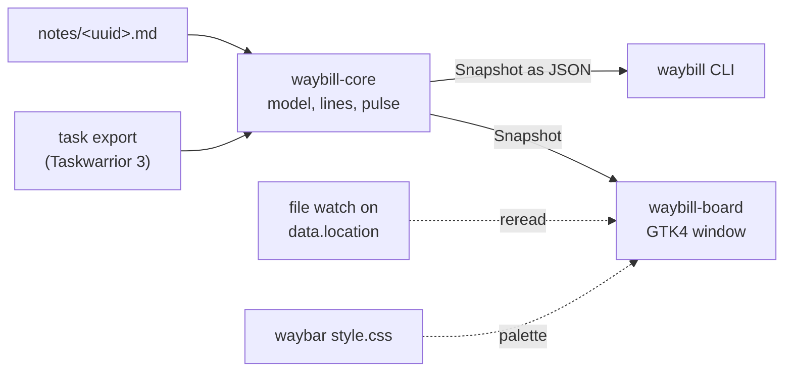

# Waybill design

Waybill is a board for a Taskwarrior list that agents write and a person
steers. It reads the list through `task export`, sorts it by who each task is
waiting on, and draws it five ways in a GTK4 window that rereads the list
whenever the database changes.

This document is the reference for how it works and why. The README is the
tour; this is the spec.

## Goals

1. **Show who the work waits on.** Every open task is waiting on an agent,
   on the user, on another task or on a date. That split is the layout.
2. **Rank the user's queue by what it frees.** The first thing on the desk
   is the task whose closing starts the most other work.
3. **Stay current without being asked.** A change to the database shows up
   on the board within about a second.
4. **Make the record readable.** Visits, rulings, commits and notes are
   shown as history and prose, not as counts.
5. **Draw the numbers.** Flow, open work, working hours and lifetimes are
   charts you can hover, not reports you run.
6. **Ask nothing of memory.** Everything is reachable with the pointer, and
   every key is printed where it applies.
7. **Leave Taskwarrior in charge.** Waybill keeps no database of its own.

## Non-goals

- **Not a Taskwarrior replacement.** `task` owns the data, urgency, sync and
  hooks.
- **Not a team tracker.** One person, their machine, their agents.
- **Not a terminal UI.** It is a window, drawn with GTK and cairo.

## Vocabulary

| Term | Meaning |
|---|---|
| Card | One task as the board shows it. |
| Lane | Where an open card stands: ready, doing, yours, held or parked. Finished cards are done (today) or past (this week). |
| Hands tag | A tag that means the task needs a person: `tags.hands` in the config. |
| Yours | A task with a hands tag or the decision tag. |
| Visit | An annotation: one line an agent or the user logged while working the task. |
| Ruling | A visit that opens with the user's name ("Nate: ..."): a decision, recorded. |
| Frees | The open tasks that cannot start until this one closes, however far down the chain. |
| Line | A group of tasks tied together by `depends`, drawn as a rail line. |
| Stop | One task on a line. |
| Note | The task's long-form Markdown file, `<uuid>.md`. |
| Snapshot | Everything the views draw, built in one pass from one export. |

## Architecture



Three crates:

- **`waybill-core`**: pure functions from exported tasks to a `Snapshot`.
  No UI and no clock of its own: callers pass `now` and a `Zone`, which is
  what makes it testable and lets the demo and screenshots be exact.
- **`waybill`**: the CLI.
- **`waybill-board`**: the window.

There is no daemon yet. The board reads the list itself, on a worker thread.
The daemon arrives with claims (stop 3) and the bar lamp (stop 4), which need
something resident; until then it would be a process with nothing to do.

### Reading the list

One command reads everything:

```
task rc.verbose=nothing rc.gc=off rc.confirmation=off rc.json.array=on export
```

`rc.gc=off` matters: without it a report can renumber task ids as a side
effect, and looking at the list would change it. Waybill addresses tasks by
uuid and never by id.

`task.command` may carry arguments (`task rc:~/work.taskrc`). The notes
folder is `notes/` under `task _get rc.data.location` unless `notes.dir`
names another. Only the names of the note files are read up front; a note's
text is read when its card is opened.

A failed read becomes a snapshot with `error` set, and the board shows the
reason in a banner over whatever it drew last.

### Staying current

The board holds a directory watch on `data.location` and one on the notes
folder. A change wakes the loader thread, which waits 350 ms for the burst
to finish and reads once. It also rereads every 60 seconds so that elapsed
times ("held 12 min") keep counting.

Reading the database can touch its files (SQLite's journal), which would
wake the watch and loop forever. So the loader keeps a `quiet` deadline:
watch events are ignored while a read is running and for 1.5 seconds after
it. A real change that lands inside that window is picked up by the next
60-second read.

Views that are not on screen are marked stale and redrawn when they are
next shown.

## The model

### Lanes

An open task (pending, or Taskwarrior 2's `waiting`) goes to the first lane
that fits:

| Lane | Rule |
|---|---|
| Doing | It has a `start`. |
| Parked | Its `wait` date is in the future. |
| Yours | It has a hands tag or the decision tag. |
| Held | One of its `depends` is still open. |
| Ready | None of the above: an agent can pick it up. |

A finished task is **done** if it closed since local midnight and **past**
if it closed in the last seven days. Past cards are not on the board; they
exist so the log and the card pane can open them. Deleted and older
finished tasks have no card.

A card of yours that is also blocked stays in Yours, with `blocked` set, so
the desk shows everything that will need the user and says which of it
cannot start yet.

Lane order: Doing by start time; Done by finish time, newest first; Yours
by how many tasks it frees, then unblocked first, then priority, then
urgency; the others by Taskwarrior's urgency.

### What a card frees

`frees` is the transitive closure of open dependents: everything that waits
on this task directly or through other open tasks. `waits_on` is the direct
open dependencies. A finished dependency holds nothing.

The header lamp is amber when a task of the user's frees anything, or a
decision is open. It is red when the list could not be read.

### Lines

Open tasks joined by `depends` form groups (union-find over the edges). A
finished dependency stays on its line for 14 days, so a line shows the track
already travelled. A group with one stop is not a line.

Each stop gets:

- a **column**: the longest run of stops that must close before it;
- a **track**: the tallest child (the one with the longest run after it)
  continues its parent's track, and every other branch takes the next free
  track. The trunk therefore runs straight and branches peel off below it;
- a **state**: done, doing, next (nothing open before it), waiting or parked.

A line is named for the title prefix its stops share ("Netplay: handshake",
"Netplay: clock sync" make **Netplay**, and the prefix is dropped from the
stop names) when at least two stops and half the line share one. Otherwise
it is named for where it ends ("To: ...") or, when it fans out, where it
starts ("From: ...").

### The log

Every visit, finish and add from the last seven days, newest first, capped
at 2,000 entries. Commit ids are pulled out of visit text: lowercase hex
words of 7 to 12 characters, where a word of digits only counts unless it
is longer than 8 or reads as a date (`20261118`).

### The pulse

Counted over 42 local days ending today:

- per day: finished, added, visits, and the open tasks at the end of the
  day split into yours and agents' (using each task's tags as they are now);
- visits by weekday and hour over the last four weeks;
- per project: open, yours, started, finished this week and a two-week
  sparkline of finished per day;
- how long finished tasks lived from added to done, in six buckets;
- the share of visits that name a commit, the median hours a decision stayed
  open, and how many of the user's tasks hold others up.

Days are counted in the user's zone, daylight saving included: a task
finished at 03:00 UTC belongs to the evening before in Chicago.

## The board

A normal GTK4 application window (`io.github.nathanielinman.Waybill`), not a
layer-shell drawer: five views need room. The header has the lamp, the lane
counts, the tabs and a two-week sparkline of finished tasks. The footer says
what the current view is for and prints the keys.

| View | Key | Question |
|---|---|---|
| Board | 1 | Where is everything right now? |
| Desk | 2 | What is waiting on me, and what does it free? |
| Lines | 3 | What has to happen in what order? |
| Log | 4 | What happened while I was away? |
| Pulse | 5 | How is the work flowing? |

Clicking a card, a desk row, a log row or a stop opens the **card pane**,
which slides over the right edge of the view so the view under it never
reflows. `Esc` closes it. It shows the card's state, what it frees and
waits on (each a button to that card), the note and the visits.

The note is laid out by `note.rs`, which reads headings, paragraphs,
bullets, `- [ ]` checkboxes, fenced code, inline code and bold. It is not a
Markdown implementation and does not try to be.

### Drawing

Everything that is drawn rather than laid out lives in `charts.rs` as a
`Canvas`: a drawing area that owns its data, grows in when its view comes on
screen (700 ms, ease-out) and knows where the pointer is, so each chart
draws its own hover state and tooltip. Charts obey GTK's "enable
animations" setting.

Chart text uses cairo's own text calls with the palette's font, so the
charts carry the same face as the widgets around them.

### Theme

One `Palette` feeds both the stylesheet (as `@define-color wb_*` tokens,
written ahead of `style.css` when it loads) and the charts, which cannot
read CSS. With `theme.from = "waybar"` the window takes the bar's background
(darkened, and made opaque if the bar is transparent), foreground and font,
and any colors the bar names (`frost`, `green`, `yellow`, `red`, `purple`,
`orange`, `blue`, `teal`). `~/.config/waybill/style.css` is layered on top
at user priority; it restyles widgets but not charts.

Color has fixed meanings: the accent is agents' work, amber is the user's,
green is started or finished, violet is a decision, red is high priority or
a failure. A project's color is separate: a stable pick from six hues,
shared by a dotted family (`plos.db` and `plos.origins`).

The board watches the bar's stylesheet, its own config and its own
stylesheet, and restyles when any of them changes.

## Config

`~/.config/waybill/config.toml`. Unknown keys are an error; a file that does
not parse is ignored with a message and the defaults are used.

| Key | Default | Meaning |
|---|---|---|
| `task.command` | `"task"` | The Taskwarrior command, with any arguments. |
| `notes.dir` | `""` | Notes folder; empty means `notes/` under `data.location`. |
| `tags.hands` | `["me"]` | Tags that mean the task needs the user. |
| `tags.decision` | `"decision"` | The tag for a task blocked on a choice. |
| `theme.from` | `"waybar"` | `"waybar"` or `"none"`. |
| `theme.font` | the bar's | Font family for the window and charts. |
| `theme.accent` | the bar's | The accent color. |

`WAYBILL_CONFIG_DIR` moves the config folder.

## Command line

`waybill snapshot` prints the snapshot as one line of JSON and exits
non-zero if the list could not be read. `waybill lanes` prints each lane's
count and first five cards. Both take `--demo`.

`waybill-board` takes `--demo`, and for screenshots `--snapshot <file>`,
`--shot <png>`, `--tab <view>`, `--open <title text>` and
`--size <w>x<h>`. `--shot` draws every chart fully grown, forces the size on
the page (a headless display may be smaller than the window) and exits
after one frame.

## What comes next

1. **Touch.** Start, stop, finish, visit, add and reprioritize from the
   board. Every write is a `task` command, so urgency, hooks and the sync
   format stay Taskwarrior's. Drag between lanes, a button with its key
   printed for every action, a `/` line for plain words, decisions answered
   with one key (writing the ruling as a visit), note editing.
2. **Agents.** `waybill next`, `visit`, `done`, `ask` and `lint` with JSON
   out. `next` clears stale starts, applies the pick filter and starts the
   task under a **claim**: who holds it (session, repo, worktree, pid),
   kept in the runtime directory so a reboot empties it. A started task
   with no live claim is stale.
3. **The bar.** A daemon, a waybar module whose lamp follows the header
   lamp's rule, and a layer-shell Desk drawer anchored with `bar-anchor`
   like Switchyard's board.
